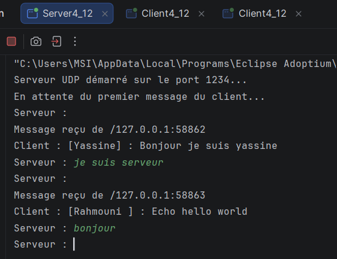
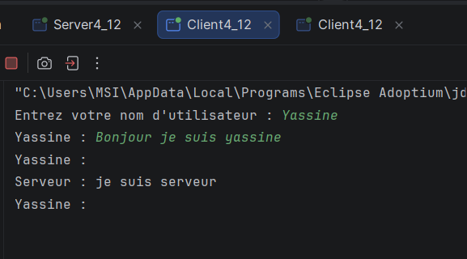
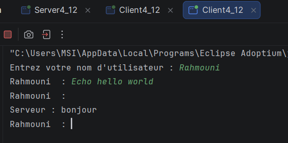
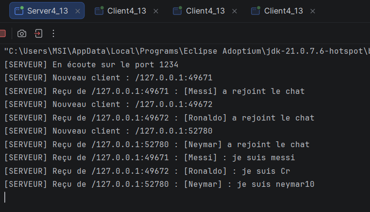
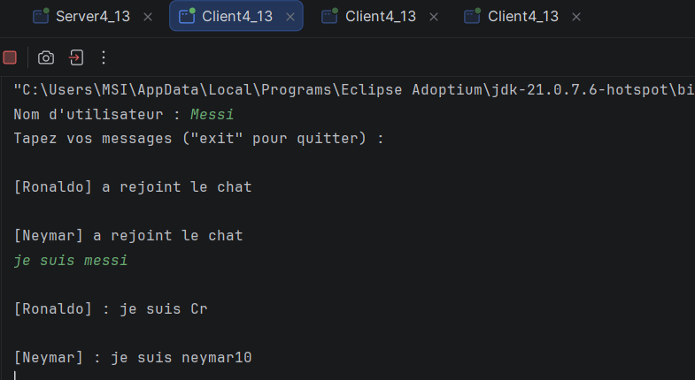
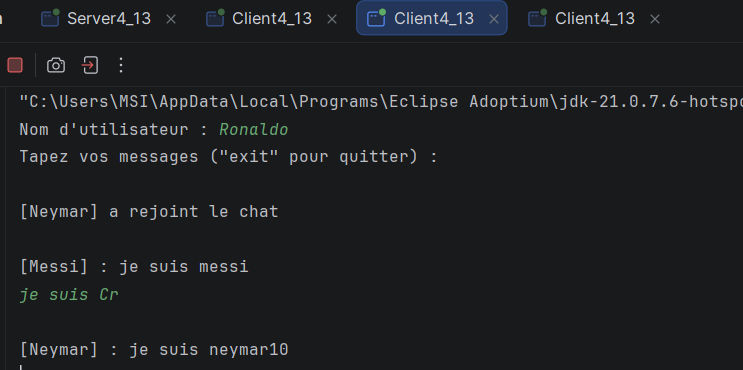
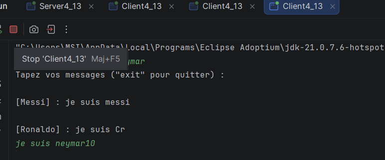

# TP4 - Communication client-serveur avec UDP

*Serveur 4.12 : réception des messages de deux clients et envoi de réponses.*

*Client Yassine : envoi d'un message et réception de la réponse du serveur.*

*Client Rahmouni : échange de messages avec le serveur.*

*Serveur 4.13 : enregistrement de plusieurs clients et réception de leurs messages.*

*Client Messi : participation au chat et réception des messages des autres clients.*

*Client Ronaldo : échange de messages dans le chat.*

*Client Neymar : réception et envoi de messages dans le chat.*

## Synthèse

Ce TP met en œuvre une communication client-serveur en Java à l'aide du protocole UDP et des classes `DatagramSocket` et `DatagramPacket`.

Les différentes versions illustrent une progression :

- **4.1** : envoi d'un datagramme du client vers le serveur, qui l'affiche à sa réception.
- **4.12** : échange de messages entre le serveur et un client. Des threads distincts permettent de recevoir des messages tout en continuant à en saisir et à en envoyer.
- **4.13** : évolution vers un chat pouvant accueillir plusieurs clients. Le serveur mémorise leurs adresses et diffuse chaque message aux autres clients ; la commande `exit` permet au client de quitter.

UDP ne nécessite pas d'établir une connexion avant l'échange. Il est donc léger, mais ne garantit ni la livraison ni l'ordre des messages. Le serveur et les clients doivent être lancés séparément ; ils utilisent le port **1234** et communiquent ici sur la machine locale (`localhost`).